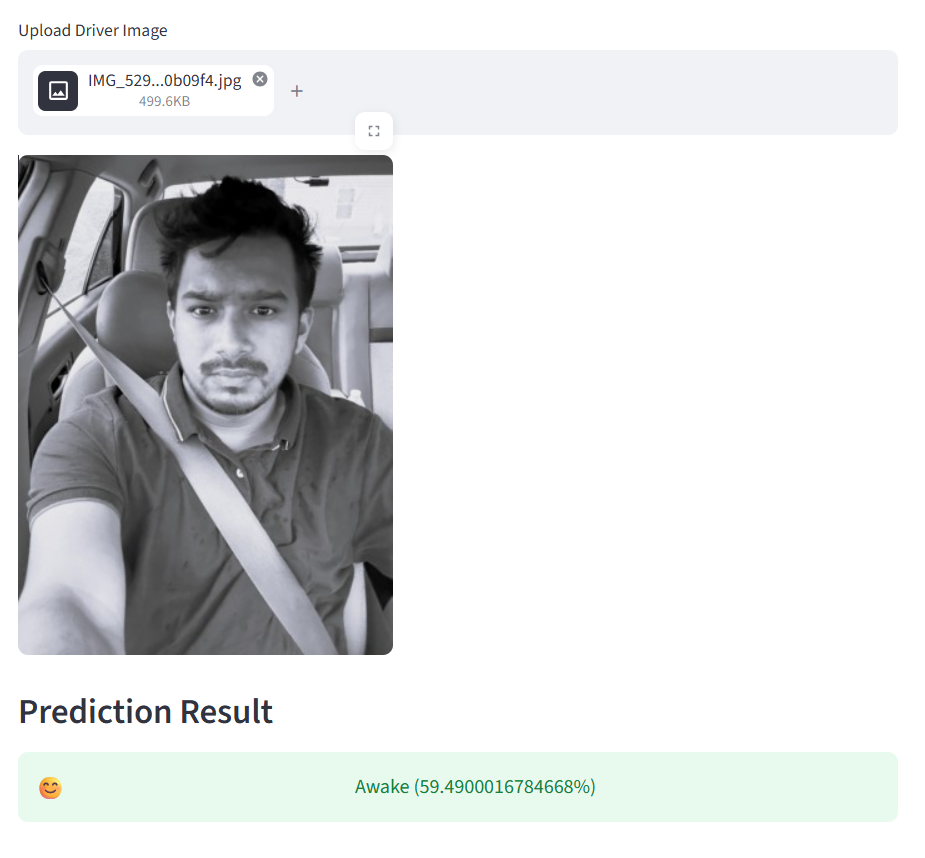
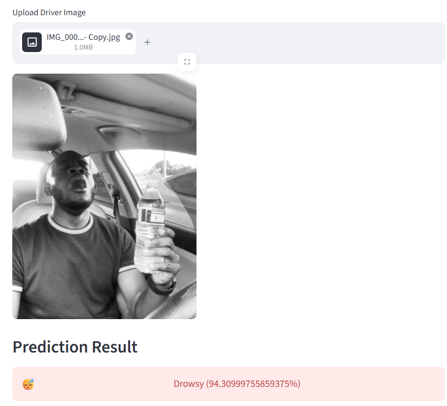

# Driver Drowsiness Detection using CNN

A deep learning project that classifies a driver's face image as **Drowsy** or **Awake** using a Convolutional Neural Network (CNN). The trained model is served through a simple **Streamlit** web app: upload an image and get the prediction with a confidence score.

Built with Python, TensorFlow/Keras and Streamlit as part of my AI & ML internship.

## Demo

| Awake | Drowsy |
|-------|--------|
|  |  |

## Features

- Binary image classification (Drowsy vs Awake) using a CNN
- Data augmentation (rotation, zoom, horizontal flip) to improve generalisation
- Train, validation and test split with accuracy evaluation
- Streamlit web app with image upload and prediction confidence

## Model Architecture

- 3 convolution blocks (32, 64 and 128 filters, 3x3 kernels, ReLU) each followed by max pooling
- Flatten, then Dense layer (128 units, ReLU) with Dropout (0.5)
- Output: 1 neuron with sigmoid activation (binary classification)
- Loss: binary cross-entropy, Optimizer: Adam, Epochs: 15

**Test accuracy:** XX% (replace XX with the value printed by `train.py`)

## Project Structure

```
README.md
requirements.txt
app.py                  # Streamlit web app
train.py                # Model training and evaluation script
result1.png             # Result screenshot (Awake)
result2.png             # Result screenshot (Drowsy)
drowsiness_data/        # A few sample images from the dataset
```

## Dataset

The full dataset is not included because of its size. Download it here: **[ADD DATASET LINK HERE]**

Place it in this folder structure before training:

```
dataset/
└── Drowsiness Dataset/
    ├── train/
    ├── valid/
    └── test/
```

A few sample images are in the `drowsiness_data` folder.

## Trained Model

The trained model file (`drowsiness_model.h5`, about 128 MB) is too large for GitHub. Download it here: **[ADD GOOGLE DRIVE LINK HERE]**

Place `drowsiness_model.h5` in the same folder as `app.py`.

## How to Run

1. Clone the repository
   ```
   git clone https://github.com/posi19babu/driver-drowsiness-detection.git
   cd driver-drowsiness-detection
   ```
2. Install the requirements
   ```
   pip install -r requirements.txt
   ```
3. (Optional) Train the model yourself after adding the dataset
   ```
   python train.py
   ```
   This saves `drowsiness_model.h5`.
4. Download `drowsiness_model.h5` (link above) if you skipped step 3, then start the app
   ```
   streamlit run app.py
   ```
5. Open the local URL shown in the terminal, upload a driver image and see the prediction.

## Tech Stack

Python, TensorFlow/Keras, NumPy, Pillow, Streamlit

## Author

**Menni Posibabu**
[LinkedIn](https://www.linkedin.com/in/posibabumenni/) | [GitHub](https://github.com/posi19babu) | [Portfolio](https://posi19babu.github.io/portfolio/)
